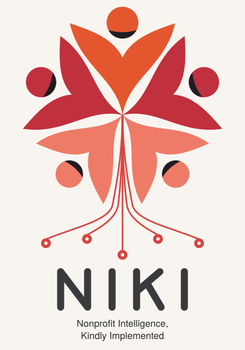

# Niki — Brand Guide

  

**Niki** is the product name for the platform formerly called *Gestionale ETS*.
Tagline: **Nonprofit Intelligence, Kindly Implemented.**

This document is the single source of truth for the name, logo, palette, type and
voice. When something here changes, update it here first.

---

## Name

| | |
|---|---|
| **Name** | Niki (always written *Niki* in text, *NIKI* only in the logo wordmark) |
| **Tagline (EN)** | Nonprofit Intelligence, Kindly Implemented |
| **Descriptor (IT)** | *Niki — il gestionale gentile per il Terzo Settore* |
| **Pronunciation** | *NEE-kee* |

### Meaning

- **Persian *nīkī* (نیکی)** — goodness, kindness, a good deed. It is the word at the
  heart of the Zoroastrian ethical triad *pendār-e nīk, goftār-e nīk, kerdār-e nīk*
  — good thoughts, good words, good deeds.
- **Greek *Νίκη*** (pronounced *Niki* in modern Greek) — victory.

The triad maps onto the product:

| Triad | In Niki |
|---|---|
| Good thoughts | AI that helps the organization think and organize |
| Good words | Convocations, minutes and communications |
| Good deeds | The work volunteers do, which Niki exists to support |

### Spelling rules

- No diacritics in the brand: **Niki**, never *Nìkì*, *Nikì* or *Nīkī*. The macron
  spelling *nīkī* is used only when explaining the etymology.
- Never *Nichi* (reads as a political name in Italy, and loses the *k* of both roots).
- Never *NiKi*, *niKi* or other mixed case.

---

## Positioning

> **The others help you do the accounts. Niki helps you look after your people and
> govern your association properly.**

- **People-first.** The person (their history, roles, consents, participation) is the
  centre of the product, not the ledger.
- **Simple on the surface, precise underneath.** Built for volunteers of every age,
  including older secretaries and treasurers, without giving up legal precision.
- **Privacy-first AI.** AI runs on infrastructure we control; data is not sent to
  large AI providers or used for training. AI proposes, a person confirms.
- **Fair and accessible.** What the law requires should be free; we charge fairly
  for what costs us money to run.
- **Human touch.** Onboarding and setup are done with people, not just a sign-up form.

---

## Logo

The mark is a **poppy (papavero) made of people**: five figures with raised arms
form the petals, all meeting at one heart. Each head carries a black smile on its
inner edge, centred on the figure's own axis and facing the heart — every person
smiling toward what they share, and an echo of the poppy's black heart. The smile is
a solid crescent cut from the head's inner edge (graphic, not an emoji line). Below, thin roots end in nodes: the community is
**rooted**, and the roots are also a **network** — the technology underneath. Each
root ends in a solid red node with a small cream hole.

Why a poppy: a wildflower that grows anywhere without tending, always in fields,
never alone. Deliberately *not* a red rose, which in Europe is a socialist /
social-democratic party emblem.

### Assets

| File | Use |
|---|---|
| [`client/public/brand/niki-logo.svg`](../../client/public/brand/niki-logo.svg) | Full lockup: bloom, roots, wordmark, tagline. Website, documents, login. |
| [`client/public/brand/niki-mark.svg`](../../client/public/brand/niki-mark.svg) | Bloom only, transparent background. App icon, avatars, small spaces. |
| [`client/public/favicon.svg`](../../client/public/favicon.svg) | Same as the mark. |

All shapes are flat fills; every figure is the same `#body` path rotated and scaled,
so edits to one figure propagate to all five. The wordmark is drawn as round-capped
strokes, not text, so it renders identically everywhere. The tagline is still live
text (Lexend with fallbacks) and should be converted to outlines for print.

### Planned variants (not yet made)

- **Horizontal lockup** — mark left of the wordmark, for the app header.
- **Monochrome** — all charcoal, and all off-white for dark backgrounds and fax/print.

### Usage rules

- Keep clear space around the logo of at least the height of one head.
- Don't recolour individual figures, add outlines, gradients or shadows.
- Don't place the full-colour logo on red or busy backgrounds; use monochrome.
- Below ~48px, use the mark only (the roots and tagline disappear at small sizes).

---

## Palette

### Brand colours (logo and marketing)

| Role | Name | Hex |
|---|---|---|
| Top figure | Vermilion | `#E4572E` |
| Side figures | Crimson | `#C0303D` |
| Lower figures | Coral | `#EE7B67` |
| Roots / network | Poppy red | `#D64541` |
| Faces, text | Charcoal | `#1F1D24` |
| Wordmark | Graphite | `#3A3A3C` |
| Background | Cream | `#F8F5F0` |
| Deep accent | Wine | `#8E1B2C` |

### UI themes

The app exposes two presets in [`client/src/themes.ts`](../../client/src/themes.ts):
`niki-light` and `niki-dark` (selectable in Settings → Theme). Interactive accents are
darker than the logo reds so that white button text meets WCAG AA.

| Pair | Contrast |
|---|---|
| Charcoal `#1F1D24` on cream `#F8F5F0` | 15.3 : 1 |
| White on crimson `#C0303D` (light theme buttons) | 5.6 : 1 |
| Crimson `#C0303D` on cream (links) | 5.2 : 1 |
| White on `#CF3F3F` (dark theme buttons) | 4.7 : 1 |
| Muted text `#8A8490` on cream | 3.3 : 1 — large/secondary text only |

### Red in the interface

Red is the brand colour, and users (especially older ones) also read red as
"error" or "danger". So:

- Use red for brand moments, primary actions and highlights — not everywhere.
- Error and destructive states must also use an icon and text, never colour alone.

---

## Typography

| Use | Typeface |
|---|---|
| Wordmark | Custom round-capped strokes (in the SVG) |
| Tagline, headings | Lexend (fallback: Outfit, Avenir Next, Helvetica Neue) |
| UI body | Current app font stack (Inter / system) until a type pass is done |

Accessibility baseline for the app: body text 16px minimum, generous line height,
buttons labelled with words (not icon-only).

---

## Voice

- **Warm, plain, respectful.** Simple Italian, no jargon (*Persone*, not *Anagrafiche*).
- **Helpful about the law, never scary.** Explain the rule and the fix:
  *"Lo statuto richiede 8 giorni di preavviso: ne mancano 2."*
- **Honest about AI.** Say what it does, where data goes, and that a person decides.

---

## Rename status

The product is being renamed incrementally. Done so far:

- Logo, mark and favicon; browser tab title (`client/index.html`)
- `niki-light` / `niki-dark` theme presets
- Docs: this guide, README, CLAUDE.md, DATABASE.md, DEPLOYMENT.md headers

Still named *Gestionale* / *gestionale-ets* (to change in later passes):

- UI strings: sidebar title and `document.title` (`client/src/hooks/useBranding.tsx`,
  `client/src/components/Sidebar.tsx`), locale placeholders in `client/src/locales/`
- Package names, repo name, Cloudflare project/worker names and staging URLs
- Default theme is still `dark-slate` (DB column default and server fallback)
- `ETS_Gestionale_PRD.md` (historical document, intentionally unchanged)

Note: an organization's own name and logo (Settings → Branding) are separate from the
Niki product brand and continue to appear for that organization's users.
